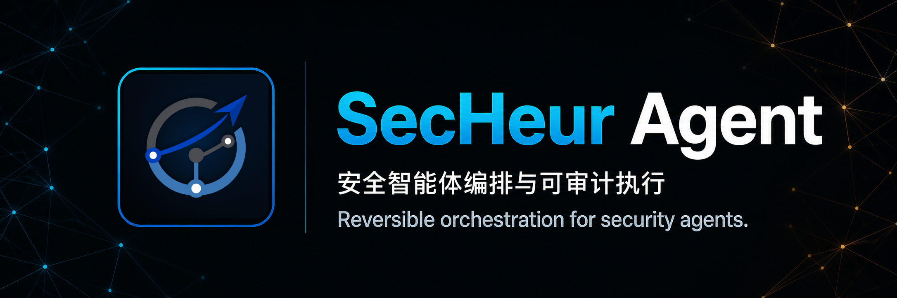
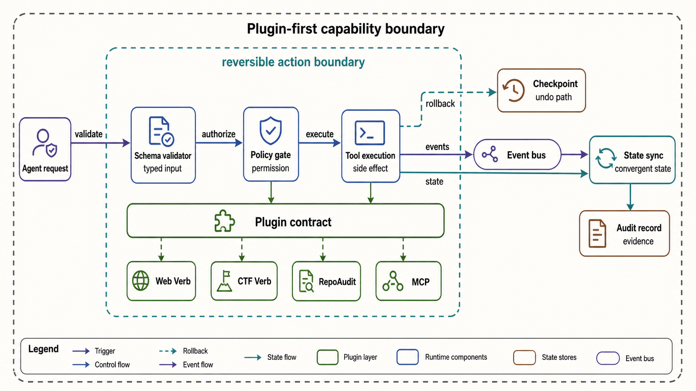
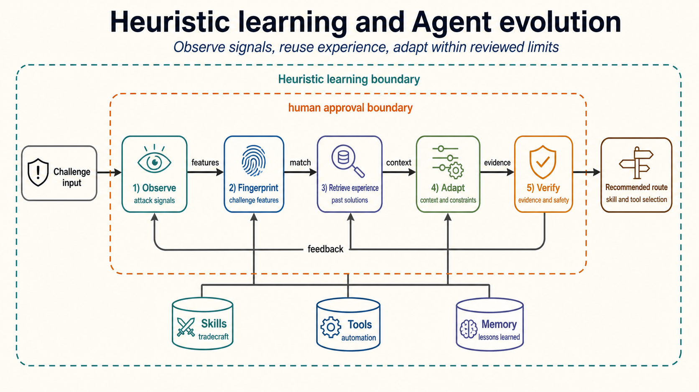
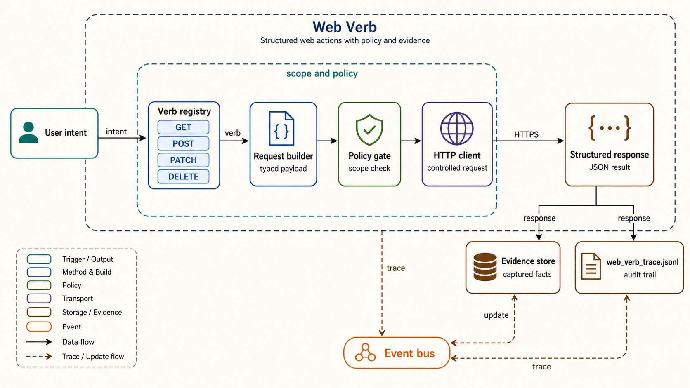
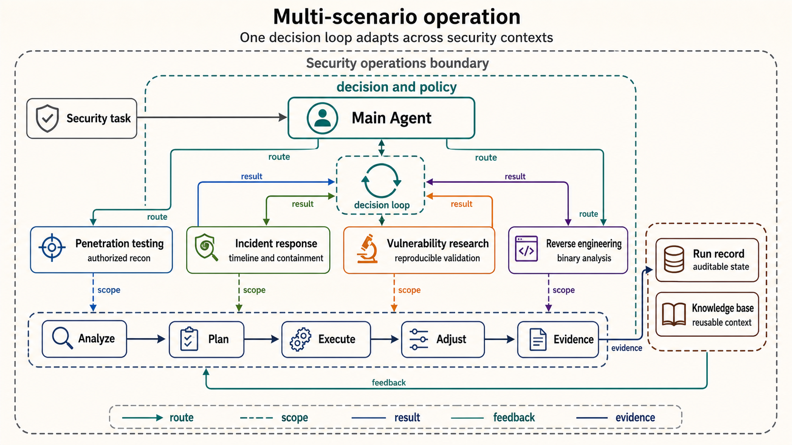
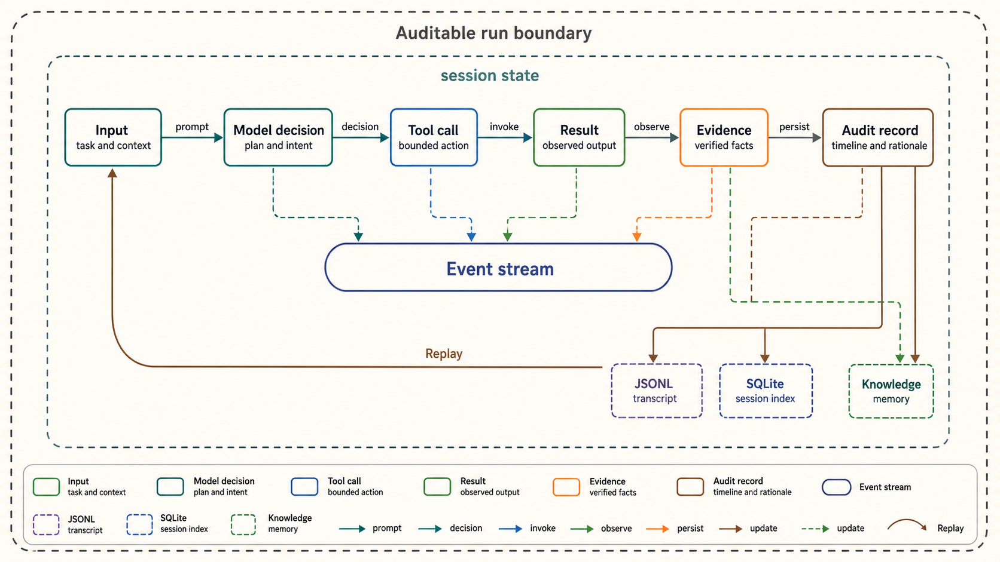
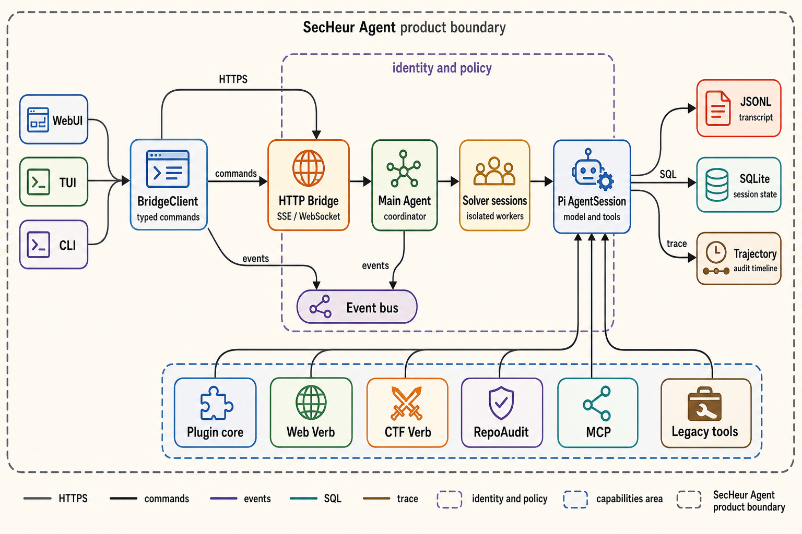
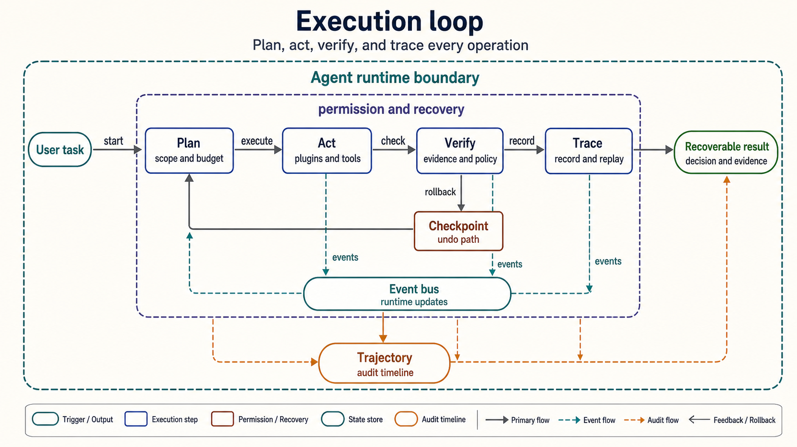

# SecHeur Agent

  

  <a href="https://nodejs.org/">=22.19.0"></a>
  
  
  

  
  
  
  

  <strong>English (default)</strong>
  ·
  <a href="README.zh-CN.md">中文</a>

> A reversible, auditable, self-evolving Agent platform for real-world cybersecurity.

SecHeur Agent is a security-agent runtime built on the Pi Agent Harness. It puts model calls,
tools, plugins, knowledge, MCP, CTF capabilities, sessions, and the desktop WebUI into one
observable execution chain, so the Agent can move from situational analysis to delivery while
retaining human approval, evidence, and recovery paths.

In one sentence:

> Keep every component action reversible over time and every shared behavior consistent across space.

Here, "time" means runtime changes to files, processes, context, and external services; "space"
means dependencies and shared resources between components. When a component or its environment
changes, other components receive an event and update instead of continuing with stale state.

> [!IMPORTANT]
> This project is intended for authorized security research, competitions, and internal defense.
> Confirm scope, test windows, and data handling requirements before use. Do not scan, exploit,
> or submit actions against systems without authorization.

## Product Positioning

Traditional scripts execute fixed steps and general-purpose Agents generate plans. Security
operations also need three things:

1. Controlled action: high-risk operations have permission gates, budgets, and stop paths.
2. Reviewable process: every important decision can be linked to input, tool output, and evidence.
3. Sustainable multi-tasking: the Main Agent coordinates while independent solvers execute and
   sessions remain recoverable after a disconnect.

SecHeur Agent unifies these requirements in the Pi Agent loop. Pi owns models, context
compaction, streaming, and session semantics; SecHeur owns security policy, plugin lifecycle,
competition coordination, compatibility tools, and deployment boundaries. Each layer has one
responsibility, so the frontend does not duplicate the Agent loop.

## Core Capabilities

Security work repeatedly runs into a small set of operational problems. Each capability below
starts with the problem and then maps it to a concrete SecHeur Agent mechanism.

### 1. Plugin-First Architecture

**Problem.** Security tools often expose side effects through incompatible commands. Permission
checks, rollback, and state updates become scattered across plugins and UI code, so an action can
finish while the broker, WebUI, and audit record show different states.

**Solution.** SecHeur Agent gives every capability a typed plugin contract. Schema validation and a
policy gate run before tool execution; Git checkpoints, cancellation, and recovery provide a
reversible boundary. Extension hooks, <code>onUpdate</code>, SSE/WebSocket events, and broker
state propagate changes to every consumer.

- Typed schemas expose tool parameters, permissions, and structured results.
- Pi extension hooks receive session, tool, and runtime events.
- When an MCP server is offline, the loader records diagnostics without preventing Agent startup;
  <code>mcp_refresh</code> can reconnect it.

Integrated plugins and extensions include RepoAudit, Web Verb, CTF Verb, the competition
coordinator, Ultracode, and SecHeur policy. Each has an independent test and packaging boundary,
so security logic does not need to be scattered across page event handlers.

### 2. Heuristic Learning and Agent Evolution

**Problem.** The same attack pattern can look different across challenges. Without experience
retrieval, the Agent repeats expensive tool trials; without relevance review, an old solution can
be applied to the wrong context.

**Solution.** The heuristic layer extracts fingerprints from challenge files, file types, Magic
values, code signals, and task descriptions. It matches historical rules, then recommends Skills,
built-in tools, MCP tools, and commands that fit the current evidence.

Enable it with:

~~~bash
SECHEUR_TOOL_EXPERIENCE=1 npm run secheur -- --model router/auto
~~~

Recommendations remain subject to permissions, target scope, tool results, and the Flag Oracle.
This is runtime experience reuse and adaptive tool routing; it does not change model weights.

### 3. Web Verb / Structured Web Actions

**Problem.** Browser workflows built from click sequences and string concatenation are brittle,
make scope implicit, and leave weak evidence when a request or submission fails.

**Solution.** Web Verb turns each action into a registered verb with a typed payload, policy check,
controlled transport, and structured result. The Agent calls <code>web_verb_call</code>, receives
JSON, and records the invocation in <code>web_verb_trace.jsonl</code>.

Common actions include:

- <code>web.fetch</code>: controlled requests, response summaries, and evidence capture.
- <code>web.extract_forms</code>: form fields, constraints, and submission requirements.
- <code>web.search_source_routes</code>: route clues from a page or its source.
- <code>web.submit_form</code>: structured submission after permission and scope checks.

The browser, TMWebDriver, and legacy web tools remain available as compatibility layers.

### 4. Multi-Scenario Operation

**Problem.** Penetration testing, incident response, vulnerability research, and reverse
engineering use different evidence and tools. Separate scripts or Agent loops duplicate lifecycle
logic and lose context when the strategy changes.

**Solution.** One runtime routes each scenario through the same decision loop: situational analysis
-> goal setting -> task planning -> execution -> evidence review -> strategy adjustment. Skills,
plugins, and tool routing carry the scenario-specific behavior.

- Penetration testing: authorized reconnaissance, validation, evidence collection, and report delivery.
- Incident response: event timelines built from alerts, logs, and host state.
- Vulnerability research: reproducible conclusions from source, runtime behavior, and minimal validation.
- Reverse engineering: binary triage, string and gadget checks, debugging, and validation.

### 5. Auditable Trajectory

**Problem.** A streamed final answer rarely explains the causal chain from input to decision, tool
call, evidence, approval, and terminal state. After a disconnect, reproducing that chain is even
harder.

**Solution.** Trajectory records give every run locatable inputs, model decisions, tool calls,
results, branches, and terminal states, then connect them to durable stores and replay views.

- Pi JSONL stores Agent context, branches, and compaction semantics.
- SQLite stores the remote session catalog, protocol transcript, and state.
- The Bridge pushes tool updates, runtime state, and solver summaries to the WebUI.
- The trajectory view supports timelines, filters, details, and error location; full output loads on demand.
- The competition broker stores task leases, environments, attachments, structured solver events, and submission audits.

The result is a conclusion that can be traced back to its justification, action, outcome, and
submission decision.

### 6. Evidence-First Knowledge Base

**Problem.** CTF writeups, prior sessions, and attack notes are distributed across raw files. A
keyword-only lookup can return unrelated or unreviewed steps, and the Agent may repeat a path that
already failed. Tool output can also contain flags, tokens, cookies, and credentials that must not
become reusable knowledge.

**Solution.** `KnowledgeRetrievalCoordinator` owns when to search, what to search, and whether to
inject a result. The main model does not call the knowledge base on the mandatory retrieval path.
It recognizes tasks in priority order, from a competition envelope to a task descriptor to explicit
attack intent, then binds the task to `web`, `pwn`, `crypto`, or `reverse`.

- `memory_search` searches local operational memory. `attack_memory_search` queries curated attack
  indexes with BM25, feature-hashing vectors, and attack-pattern reranking. For crypto topics,
  published knowledge cards are the retrieval boundary; raw writeup text stays in the local evidence
  layer.
- Retrieval has three triggers: `task_bootstrap`, `evidence_refinement` after new tool facts, and
  `stall_recovery` after a stuck verdict. Tool output is normalized into techniques, target facts,
  phases, and failed routes after sensitive values are redacted. Results from a parallel tool batch
  are merged into one next-context query.
- A deterministic quality gate rejects category mismatches, duplicate cards, missing attack labels
  or provenance, corrupted text, and prerequisite conflicts. It combines taxonomy match, evidence
  overlap, prerequisite fit, provenance, and score margin. Bootstrap and stall recovery use a `0.5`
  threshold; evidence refinement uses `0.72`, with at most one alternative-route rewrite.
- Only accepted cards are injected, ordered by score, with a limit of 3 cards and 10,000 characters.
  Each card carries recognition signals, preconditions, attack steps, a canonical PoC, failure modes,
  source URLs, review status, and verification status. The result is still a recommendation; task
  scope, permissions, tool results, and Flag Oracle control execution.
- Each session stores normalized facts and query/card identifiers in `knowledge-state.json`, and
  records triggers, fingerprints, candidate counts, decisions, rejections, latency, and errors in
  `knowledge-retrieval.jsonl`. Prompt text and raw tool output are not persisted. The legacy search
  call has a 3-second hard timeout and fails open when the shared worker is late.
- In solve mode, `attack_memory_search` is hidden from the model so the coordinator controls
  retrieval. Set `SECHEUR_KNOWLEDGE_MANUAL_TOOL=1` to expose it for debugging, or
  `SECHEUR_KNOWLEDGE_SHADOW=1` to record legacy-regex comparisons without injecting results.

See the [knowledge retrieval design](docs/secheur-rebuild/knowledge-retrieval.md) for the state
machine, thresholds, and persistence details.

## Architecture

The browser never instantiates an AgentSession or connects to a Unix socket. It sends commands
and subscribes to events through BridgeClient; the Agent loop always stays on the backend.

  

The diagram shows the entry points, transport layer, Main Agent and independent Solver sessions,
Pi AgentSession, typed plugin extensions, and persistence in JSONL, SQLite, trajectory records,
and the competition broker. Main Agent and Solver are parallel session roles, not hidden
subprocesses created by the frontend.

The architecture keeps the Agent loop on the backend. The browser sends commands through
BridgeClient and subscribes to SSE/WebSocket events; it never instantiates an AgentSession directly.

### Main Agent and Solver

The Main Agent is the competition coordinator and task planner. It synchronizes challenges, sets
the order, confirms attempt budgets, explicitly dispatches, guides, stops, and reviews solvers.
Each solver runs in its own tmux window and Pi session, so one solver's context, cancellation, or
output cannot block the others.

The WebUI only discovers and connects to registered sessions. The attach-only Bridge does not
create a hidden Agent loop; without a registered Main Agent, the page shows a waiting state
instead of silently starting a background dispatcher.

### Multi-Solver Throughput

Multi-session lag usually comes from repeatedly loading complete histories, rendering the entire
page for every token, and concentrating startup requests. The current implementation isolates
these paths:

- Session state is normalized by ID; the solver list keeps summaries only.
- The full transcript loads only after a solver is selected.
- The transcript uses a virtual list; tool output is collapsed by default with a bounded preview.
- Streaming text is appended incrementally and Markdown is rendered after completion.
- Main Agent creates solvers serially with a default 2-second interval. Set
  <code>SECHEUR_SOLVER_DISPATCH_INTERVAL_MS</code> to adjust it (range: 1 to 5 seconds).
- Competitions that need environments use at most 3 environment slots by default; attachment-only
  tasks do not consume this limit.

This controls UI and scheduling overhead without pretending independent solvers are synchronous
calls. For a 15-item benchmark, record queue wait, model time, tool time, and page render time
separately.

## Capability Overview

| Capability | Purpose | Entry |
| --- | --- | --- |
| Pi Agent loop | Model calls, context compaction, streaming output, session branching | <code>secheur</code> |
| Desktop Bridge | HTTP, SSE/WebSocket, session recovery, WebUI static assets | <code>secheur-bridge</code> |
| Remote protocol | Unix socket, SQLite catalog, cross-process sessions | <code>secheur-server</code> |
| Plugin system | RepoAudit, SecHeur policy, Web/CTF Verb, MCP | <code>packages/*-extension</code> |
| Knowledge base and Skills | Operational memory, curated attack-pattern retrieval, and reusable Skills | <code>legacy/memory/</code>, <code>legacy/.agents/skills/</code> |
| Competition coordination | Challenge sync, environment leases, solver dispatch, submission audit | <code>secheur-competition</code> |
| Ultracode | Isolated candidates, LLM-as-a-Verifier, winner patch | <code>/ultracode</code> |
| Trajectory and telemetry | Runtime timeline, evidence, parent/child spans, recovery | WebUI trajectory page |

## Repository Layout

| Path | Contents |
| --- | --- |
| <code>packages/secheur-agent/</code> | SecHeur TypeScript application layer, CLI, Bridge, broker, and tests |
| <code>packages/webui/</code> | React + Vite WebUI, external session store, and trajectory view |
| <code>packages/repoaudit-pi-extension/</code> | RepoAudit Pi plugin, doctor, and adapter tests |
| <code>packages/*/</code> | Pi Agent Harness runtime packages |
| <code>legacy/</code> | Python compatibility runtime, tools, Skills, and public knowledge |
| <code>vendor/repoaudit/</code> | Version-controlled RepoAudit Python runtime used by Docker |
| <code>docs/secheur-rebuild/</code> | Architecture, deployment, capability parity, and server audit documents |

## Deployment

### Choose a Deployment Mode

| Mode | Use case | Characteristics |
| --- | --- | --- |
| Docker Compose | New servers, shared teams, CTF tooling | Packages dependencies and the Python compatibility layer together; data persists in volumes |
| Node release package | Existing process manager or isolated release directory | Separates program and runtime data for canary rollout, switching, and rollback |
| Source development | Local debugging, plugin work, and frontend iteration | Runs TypeScript, Vite, and tests directly |

Before production deployment, prepare Node.js >=22.19.0, Python 3.10-3.13 when legacy tools
need it, Git, and controlled HTTPS, a reverse proxy, or a Tailscale network. Do not expose the
Bridge's plain-text port to an untrusted network.

### A. Docker Compose / Recommended

Run on a new machine:

~~~bash
git clone https://github.com/yg2224/SecHeur-Agent-pro.git
cd SecHeur-Agent-pro
cp .env.example .env
~~~

Fill model or competition settings in a private .env, then start the base Agent:

~~~bash
docker compose up -d --build agent
curl -fsS http://127.0.0.1:14168/status
~~~

Open http://127.0.0.1:14168/. Compose binds to the loopback address by default. Only expose
SECHEUR_BIND_HOST=0.0.0.0 for remote access behind Tailscale or a trusted reverse proxy, with
firewall rules and access controls in place.

The Docker agent service starts an attach-only Bridge by default. To make the Main Agent visible
in the WebUI, start it from a terminal sharing the same /data and /workspace:

~~~bash
docker compose exec agent /opt/secheur/node_modules/.bin/secheur --model router/auto
~~~

Check competition state from another terminal:

~~~bash
curl -fsS http://127.0.0.1:14168/competition
curl -fsS http://127.0.0.1:14168/competition/tasks
~~~

#### RepoAudit

The root Dockerfile builds a Python 3.13 runtime from vendor/repoaudit/ and does not clone an
external repository during the build. The image and entrypoint run repoaudit-doctor first. The
production service defaults to REPOAUDIT_REQUIRE_API_KEY=1, so repoaudit_scan still validates
credentials matching REPOAUDIT_MODEL.

After creating a Bridge session, confirm plugin loading with:

~~~bash
curl -fsS http://127.0.0.1:14168/session/<session-id>/tools
~~~

The response should include repoaudit_scan in tools and activeTools. If it is missing, inspect
loader diagnostics for PLUGIN_NOT_LOADED instead of silently degrading to a plain text response.

RepoAudit defaults to a 30-minute scan timeout, a 5-minute lock wait, and a 25-second heartbeat.
Heartbeats during lock wait refresh the Bridge watchdog, so queued tasks are not mistaken for
stalled work. For a 15-item benchmark, use one central FIFO queue and 5 workers with concurrency
1. The current adapter only offers a single-container file lock; REPOAUDIT_COORDINATION_MODE,
REPOAUDIT_CENTRAL_QUEUE_URL, and REPOAUDIT_SHARED_LEASE_URL are future integration points, not
an enabled distributed queue.

#### CTF Tools and Local CTFd

Enable the CTF profile when SageMath, Ghidra, pwntools, QEMU, or forensics tools are needed:

~~~bash
docker compose --profile ctf up -d --build
~~~

The full image takes longer to build and uses more disk. For the base tools only, set:

~~~dotenv
INSTALL_SAGE=0
INSTALL_GHIDRA=0
~~~

Use the local-ctf profile for local CTFd, Redis, MariaDB, and the environment gateway:

~~~bash
CTFD_URL=http://ctfd:8000 docker compose --profile local-ctf up -d --build
~~~

The gateway accepts only prepared challenge images listed in
docker/ctf-lab-gateway/challenges.example.json; it does not download or fabricate challenge
environments. CTFd agent compatibility mode requires CTFD_AGENT_ACCESS_KEY, CTFD_AGENT_USER_ID,
and the API URL in a private environment.

The local profile pins CTFd 3.7.7, MariaDB 11.4.5, Redis 7.4.2-alpine, and a Python 3.12
gateway. The CTFd plugin exposes /slab-match/api/v1/agent for challenge details, environment
leases, and submission status. Platform tokens and AccessKeys are injected only into the broker
or Main Agent; they never enter task snapshots, solver subprocesses, or audit bodies.

Without Docker, the existing deployment assets remain in legacy/: legacy/Dockerfile is the old
full CTF base image, legacy/ctf-mcp/Dockerfile is the current canonical MCP image,
legacy/ctf-mcp/requirements.txt is the Python dependency list, and
legacy/scripts/install_ctf_tools.sh is the host tool installation script.

### B. Source Development

On a new Linux machine, use the one-shot script:

~~~bash
./install.sh
secheur self-test
~~~

The script checks or guides Node.js installation, performs an offline build, and places
secheur, secheur-bridge, and secheur-server in ~/.local/bin. You can also run:

~~~bash
npm ci --ignore-scripts
npm run build:offline
npm run secheur -- self-test
~~~

Start the Main Agent and Bridge:

~~~bash
npm run secheur -- --model router/auto
~~~

In another terminal:

~~~bash
npm run secheur:bridge
curl -fsS http://127.0.0.1:14168/status
~~~

For WebUI development, run Vite separately. The development server proxies session and event
requests to the Bridge:

~~~bash
npm run dev --workspace=@secheur/webui
~~~

The default address is http://127.0.0.1:5173/. Production builds output to
legacy/frontends/desktop/static/webui/, which the Bridge serves.

### C. Release Package and Canary

When program files must be separated from existing server runtime data, build a release package
on the development machine:

~~~bash
npm ci --ignore-scripts
npm run build:offline
npm run verify:dist --workspace=@secheur/agent
mkdir -p /tmp/secheur-release
npm pack --workspace=@secheur/agent --pack-destination /tmp/secheur-release
~~~

Copy the tarball through a controlled channel into an independent release directory on the server,
then install it:

~~~bash
mkdir -p /path/to/secheur-agent-pi/current
cd /path/to/secheur-agent-pi/current
npm init -y
npm install --omit=dev --ignore-scripts /path/to/secheur-agent-0.1.0.tgz
./node_modules/.bin/secheur --help
./node_modules/.bin/secheur-bridge --help
./node_modules/.bin/secheur-server --help
./node_modules/.bin/secheur-competition --help
~~~

Run a canary with an independent configuration first; do not overwrite the old Python directory:

~~~bash
SECHEUR_PROJECT_ROOT=/path/to/secheur-agent \
SECHEUR_CONFIG_DIR=/path/to/secheur-agent/.secheur-agent \
SECHEUR_PYTHON=/path/to/secheur-agent/.venv/bin/python \
BRIDGE_HOST=127.0.0.1 \
BRIDGE_PORT=14171 \
./node_modules/.bin/secheur-bridge
~~~

After validating /status, static assets, model streaming, session recovery, Skills, MCP
diagnostics, and stop generation, switch to the production port. See
[docs/secheur-rebuild/deployment.md](docs/secheur-rebuild/deployment.md) for the complete
release, switch, and rollback procedure.

## Models, Routing, and Configuration

Model credentials can be injected through the WebUI settings page, Pi's standard auth store,
or process environment variables. The repository contains only configuration structure and
placeholders; it does not store real API keys.

The default route is router/auto:

| Reasoning level | Preferred model | Fallback |
| --- | --- | --- |
| high | Configured GLM provider | DeepSeek provider |
| medium | DeepSeek provider | Determined by provider configuration |
| low | DeepSeek provider | Determined by provider configuration |

Model and auth state usually live in pi/models.json, pi/auth.json, and pi/settings.json under
the runtime directory. Never commit these files, Cookies, session bodies, .env files, or CTF
temporary files to Git.

Common provider/model identifiers are secheur-deepseek/deepseek-v4-flash and
secheur-glm/glm-5.3. Their baseUrl, api, and authentication come from private configuration.
On first startup, SECHEUR_DEEPSEEK_API_KEY or SECHEUR_GLM_API_KEY can initialize Pi auth.json;
existing credentials are not overwritten.

An optional BigModel Responses route uses these private variables:

~~~dotenv
BIGMODEL_API_KEY=
BIGMODEL_RESPONSES_ENDPOINT=https://open.bigmodel.cn/api/v1/responses
BIGMODEL_MODEL=glm-5.3
~~~

A GLM gateway may use a complete endpoint URL. Do not append /responses or /chat/completions
automatically; use the baseUrl and api contract defined by the provider gateway.

## Competition and Ultracode

### Competition Broker

The competition broker uses an independent secheur.competition/v1 Unix socket and SQLite to
store challenge snapshots, task leases, attachment caches, solver events, and submission audits.
Start the broker with:

~~~bash
npm run secheur:competition -- --sync
curl -fsS http://127.0.0.1:14168/competition
curl -fsS http://127.0.0.1:14168/competition/tasks
~~~

Official platform adapters read SLAB_MATCH_HOST, SLAB_MATCH_ID, and SLAB_AGENT_ACCESSKEY from
private variables. The broker records attachment preparation, environment heartbeats, and
platform submissions; a local shell proof cannot replace the platform's accepted response.

The Main Agent manages independent solvers with competition_set_plan,
competition_set_attempt_budgets, competition_dispatch_solver, competition_guide_solver, and
competition_stop_solver. The WebUI only displays these persistent states; it does not execute
platform submissions directly.

The local CTFd adapter uses http://ctfd:8000 inside the Compose network and
http://127.0.0.1:18000 on the host. For PWN tasks, a local shell proof only proves a local
process or nonce shell. Only an accepted response from the adapter can enter the solved state;
after a successful submission, the broker reclaims the environment and stores writeup metadata.

### Ultracode / Isolated Candidate Verification

Use these commands in a Pi session:

~~~text
/ultracode
/ultracode status
/ultracode once <task>
/ultracode on
/normal
~~~

Ultracode runs multiple candidates in an isolated directory and uses an LLM-as-a-Verifier to
select the winner patch. The winner is applied only after at least two candidates succeed and
verification passes. ULTRACODE_FLAG_VERIFY=auto permits submission verification only when a Flag
Oracle is configured and a challenge ID is present.

Common configuration:

~~~dotenv
ULTRACODE_AGENT_MODEL=secheur-deepseek/deepseek-v4-flash
ULTRACODE_THINKING_LEVEL=max
ULTRACODE_FLAG_VERIFY=auto
ULTRACODE_VERIFIER_MODEL=secheur-deepseek/deepseek-v4-flash
~~~

## Persistence, Networking, and Security

Default Docker volumes:

| Volume | Container path | Contents |
| --- | --- | --- |
| secheur-state | /data | Settings, Pi auth, session index, Skills, and MCP configuration |
| secheur-workspace | /workspace | Project files and model configuration generated by the UI |
| ctf-work | /work | Challenge files shared by the Agent and CTF MCP |

You can replace volume names in .env with bind mounts such as ./runtime/state,
./runtime/workspace, and ./runtime/work. Confirm that container UID 1000 can write before use.

Compose binds to 127.0.0.1 by default. Prefer Tailscale or an HTTPS reverse proxy for remote
access, restrict sources, set timeouts, and redact logs. Never inject API keys into task
envelopes, solver subprocesses, or audit records.

Chrome, TMWebDriver, and real browser profiles are host capabilities and are not packaged in the
Agent container. If browser capability is unavailable, the Agent should still start; an MCP
connection failure is recorded in diagnostics and can be retried with mcp_refresh after recovery.

Daily operations:

~~~bash
docker compose ps
docker compose logs -f agent
docker compose restart agent
curl -fsS http://127.0.0.1:14168/status
docker compose exec agent /opt/secheur/node_modules/.bin/secheur doctor
docker compose exec agent /opt/secheur/node_modules/.bin/secheur self-test
~~~

Do not run docker compose down -v in an environment that contains saved data; it deletes
persistent volumes.

## Development and Verification

Basic checks:

~~~bash
npm run check
npm run check:browser-smoke
npm run typecheck --workspace=@secheur/agent
npm run typecheck --workspace=@secheur/webui
~~~

For the Python compatibility layer:

~~~bash
PYTHONPATH=legacy python3 -m unittest discover -s legacy/tests -p 'test_memory_search*.py'
~~~

For a deeper design and migration record:

- [docs/secheur-rebuild/architecture.md](docs/secheur-rebuild/architecture.md)
- [docs/secheur-rebuild/deployment.md](docs/secheur-rebuild/deployment.md)
- [docs/secheur-rebuild/parity-matrix.md](docs/secheur-rebuild/parity-matrix.md)
- [docs/secheur-rebuild/server-audit.md](docs/secheur-rebuild/server-audit.md)
- [docs/deploy-dasctf.md](docs/deploy-dasctf.md)

## License

MIT
