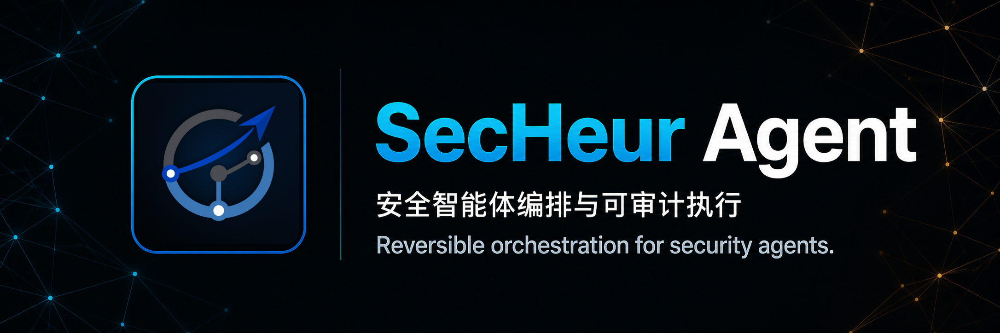
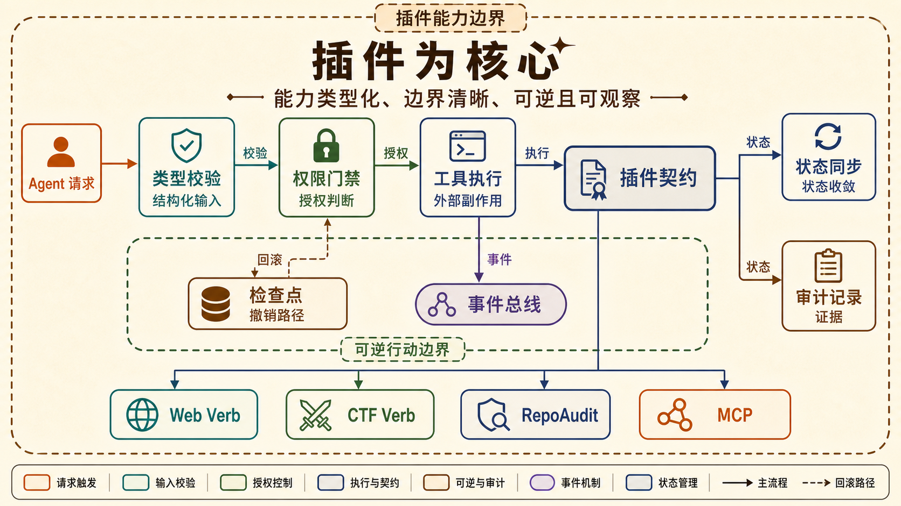
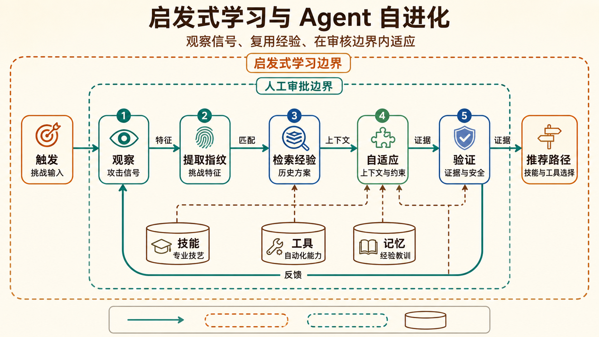
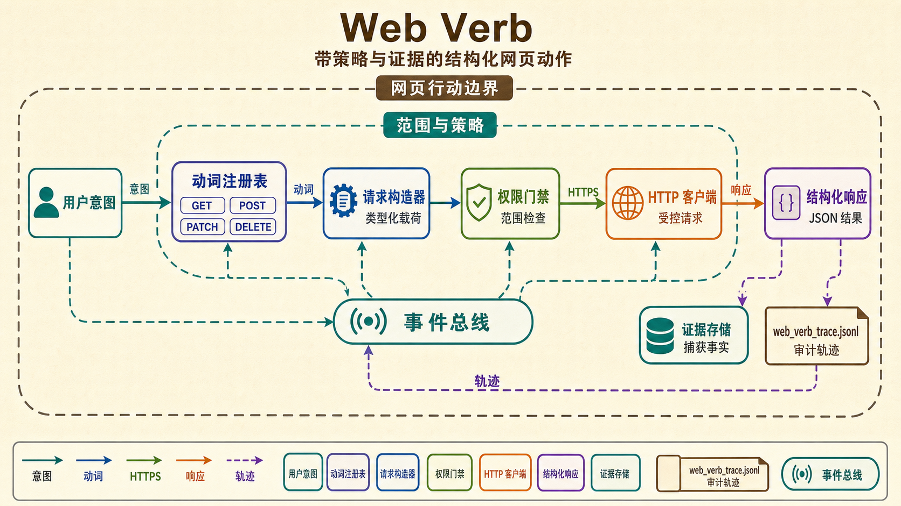
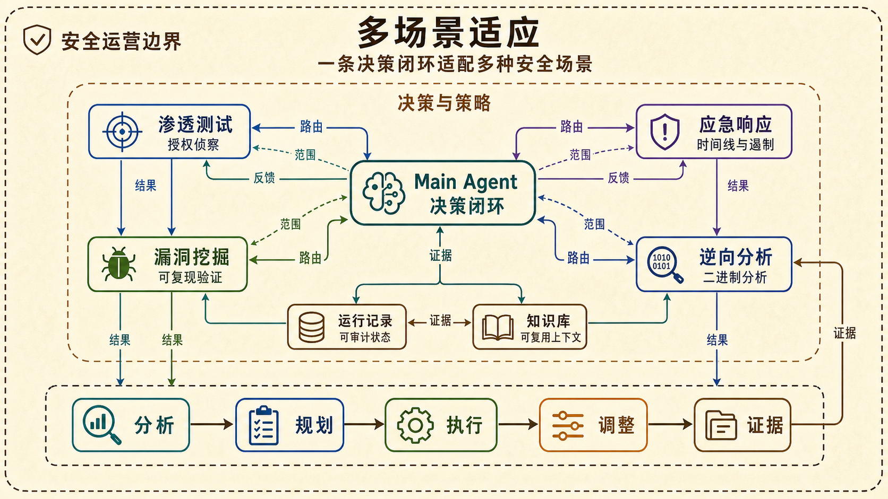
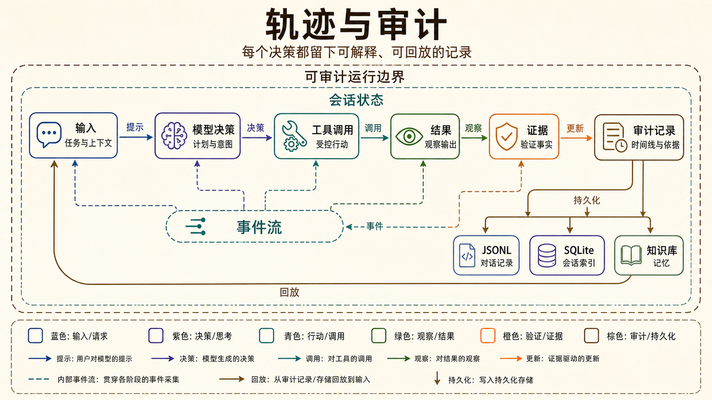
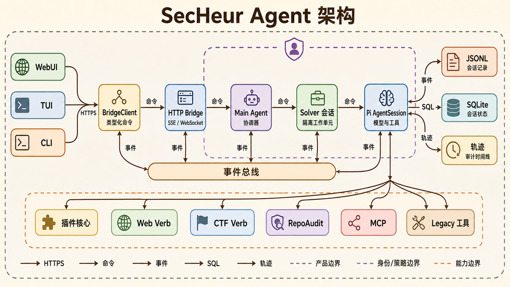
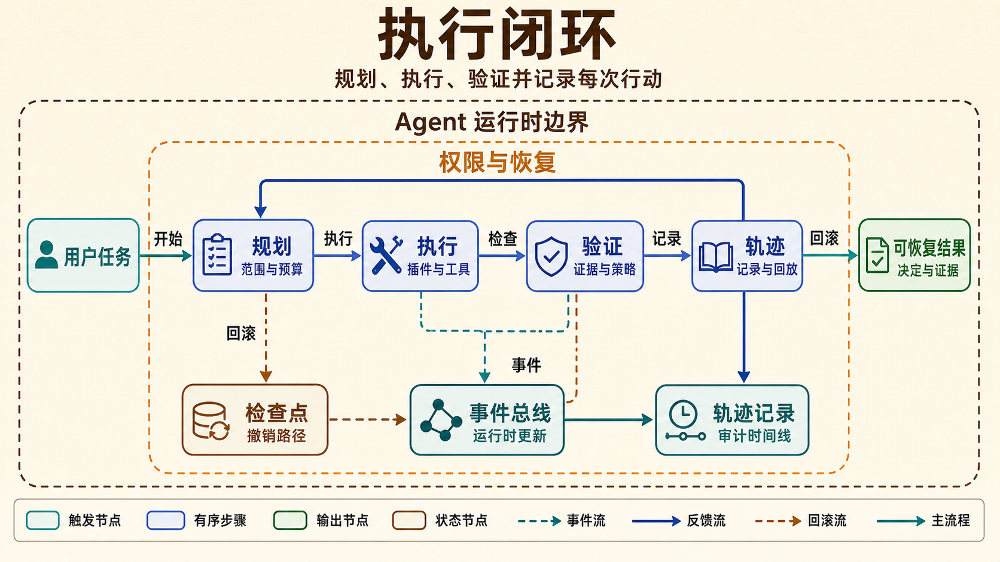

# SecHeur Agent

  

  <a href="https://nodejs.org/">=22.19.0"></a>
  
  
  

  
  
  
  

  <a href="README.md">English</a>
  ·
  <strong>中文（默认）</strong>

> 面向网络安全实战的可逆、可审计、自进化 Agent 平台。

SecHeur Agent 是建立在 Pi Agent Harness 之上的安全智能体运行时。它把模型调用、
工具、插件、知识库、MCP、CTF 能力、会话和桌面 WebUI 放进同一条可观察的执行链，
让 Agent 能够从态势分析一路走到任务交付，同时保留人工确认、证据记录和恢复能力。

一句话概括：

> 让组件在时间上的所有操作保持可逆，在空间上的所有行为保持一致。

这里的「时间」指组件运行时对文件、进程、上下文和外部服务产生的修改；「空间」指
组件之间的依赖与共享资源。当一个组件或环境发生变化时，其它组件能够收到事件并
更新，而不是继续使用过期状态。

> [!IMPORTANT]
> 本项目面向已获授权的安全研究、竞赛和内部防御工作。请先确认目标范围、测试窗口
> 和数据处理要求，不要对未授权系统执行扫描、利用或提交操作。

## 产品定位 / Product Positioning

传统脚本擅长执行固定步骤，通用 Agent 擅长生成计划，但安全实战还需要三件事：

1. 行动可控：高风险动作有权限门禁、预算和停止路径。
2. 过程可复核：每个关键决定都能关联到输入、工具结果和证据。
3. 多任务可持续：Main Agent 负责协调，独立 solver 负责执行，断线后仍能恢复会话。

SecHeur Agent 将这三件事统一到 Pi 的 Agent loop 中。Pi 负责模型、上下文压缩、
流式输出和会话语义；SecHeur 负责安全策略、插件生命周期、比赛协调、兼容工具和
部署边界。两层各司其职，避免在前端重复实现一套 Agent。

## 核心能力 / Core Capabilities

安全实战反复遇到几类运行问题。下面每项能力先说明问题，再说明 SecHeur Agent
采用的技术机制。

### 1. 插件为核心 / Plugin-First Architecture

**问题。** 安全工具常用各自不同的命令和输出格式暴露副作用。权限检查、回滚和
状态同步散落在插件或页面代码中，动作完成后 broker、WebUI 和审计记录可能显示
不同状态。

**技术方案。** SecHeur Agent 为每项能力定义 typed plugin contract。工具执行前先
经过 schema 校验和权限门禁；Git checkpoint、取消和恢复路径提供可逆边界。扩展
钩子、<code>onUpdate</code>、SSE/WebSocket 事件和 broker 状态会把变化传给所有
消费者。

- typed schema 暴露工具参数、权限和结构化结果。
- Pi extension hook 接收会话、工具和运行时事件。
- MCP server 离线时由 loader 记录 diagnostics，不阻止 Agent 启动；可用
  <code>mcp_refresh</code> 重连。

当前已接入 RepoAudit、Web Verb、CTF Verb、比赛协调器、Ultracode 和 SecHeur 权限
策略。每个插件都有独立的测试和打包边界，安全逻辑不需要散落在页面事件处理器中。

### 2. 启发式学习与 Agent 自进化 / Heuristic Learning

**问题。** 同一种攻击模式在不同题目中可能呈现出不同表象。没有经验检索，Agent
会重复昂贵的工具试错；没有相关性审查，旧方案可能被套用到错误上下文。

**技术方案。** 启发式学习层从挑战文件、文件类型、Magic、代码信号和任务描述中
提取 fingerprint，匹配历史规则，再根据当前证据推荐 Skill、内置工具、MCP 工具
和命令。

启用方式：

~~~bash
SECHEUR_TOOL_EXPERIENCE=1 npm run secheur -- --model router/auto
~~~

推荐结果仍受权限、目标范围、工具返回值和 Flag Oracle 约束。这是运行时经验复用
和工具路由自适应，不会修改模型权重。

### 3. Web Verb / Structured Web Actions

**问题。** 用点击序列和字符串拼接实现网页流程容易失效，目标范围不明确，请求或
提交失败时也难以留下完整证据。

**技术方案。** Web Verb 把每个动作定义为注册 verb，依次经过 typed payload、权限
检查、受控传输和结构化结果。Agent 通过 <code>web_verb_call</code> 调用它，接收
JSON，并将调用写入 <code>web_verb_trace.jsonl</code>。

常用动作包括：

- <code>web.fetch</code>：受控请求、响应摘要和证据保存。
- <code>web.extract_forms</code>：提取表单、字段和提交约束。
- <code>web.search_source_routes</code>：从页面或源码中定位路由线索。
- <code>web.submit_form</code>：在权限与目标范围通过后提交结构化表单。

浏览器、TMWebDriver 和原有 Web 工具仍可作为兼容层使用。

### 4. 多场景适应 / Multi-Scenario Operation

**问题。** 渗透测试、应急响应、漏洞挖掘和逆向分析使用不同的工具与证据。分别
维护脚本或 Agent loop 会重复生命周期逻辑，策略变化时还容易丢失上下文。

**技术方案。** 同一套运行时把各场景接入统一决策闭环：态势分析 → 目标设定 →
任务规划 → 执行 → 证据复核 → 策略调整。场景差异由 Skill、插件和工具路由承载。

- 渗透测试：授权范围内的侦察、验证、证据整理和报告交付。
- 应急响应：从告警、日志和主机状态建立事件时间线。
- 漏洞挖掘：结合源码、运行时行为和最小化验证形成可复现结论。
- 逆向分析：二进制 triage、字符串和 gadget 检查、调试及验证。

### 5. 轨迹机制 / Auditable Trajectory

**问题。** 流式输出通常只留下最终答案，无法说明输入如何形成决定、工具调用、
证据、审批和终态。连接中断后，这条因果链更难复现。

**技术方案。** 轨迹记录为每次运行保存可定位的输入、模型决定、工具调用、结果、
分支和终态，并将它们连接到持久化存储和回放视图。

- Pi JSONL 保存 Agent 上下文、分支和压缩语义。
- SQLite 保存远程会话目录、protocol transcript 和状态。
- Bridge 将工具更新、运行状态和 solver 摘要推送到 WebUI。
- 轨迹视图支持时间线、筛选、详情和错误定位；完整输出按需加载。
- 比赛 broker 保存任务租约、环境、附件、结构化 solver 事件和提交审计。

最终结论可以回溯到它的依据、动作、结果和提交决策。

### 6. 证据优先的知识库 / Evidence-First Knowledge Base

**问题。** CTF writeup、历史会话和攻击笔记分散在原始文件中。只按关键词检索会
混入无关或未审核步骤，Agent 还可能重复已经失败的路径。工具输出还可能包含 flag、
token、cookie 和凭据，不能直接变成可复用知识。

**技术方案。** `KnowledgeRetrievalCoordinator` 统一决定何时检索、检索什么以及是否
注入结果。强制检索路径不由主模型直接调用知识库。任务按比赛信封、任务描述、显式
攻击意图的优先级识别，再绑定到 `web`、`pwn`、`crypto` 或 `reverse` 类别。

- `memory_search` 检索本地运行记忆，`attack_memory_search` 检索经过整理的攻击索引，
  使用 BM25、feature-hashing 向量和攻击模式重排。crypto 主题以发布的 knowledge card
  作为检索边界，原始 writeup 文本留在本地证据层。
- 检索有 3 类触发：`task_bootstrap`、获得新工具事实后的 `evidence_refinement`，以及
  进度判定停滞后的 `stall_recovery`。工具输出会先脱敏，再归一化为技巧、目标事实、
  阶段和失败路线；并行工具批次的结果合并为下一次上下文检索。
- 确定性的质量门禁会拒绝类别不匹配、重复卡片、缺少攻击标签或来源、乱码文本以及
  前置条件冲突的候选。评分综合分类匹配、证据重合、前置条件适配、来源和分数差距。
  bootstrap 与 stall recovery 的阈值为 `0.5`，evidence refinement 的阈值为 `0.72`，
  最多执行一次替代路线改写。
- 只有通过门禁的卡片才会按分数注入，上限为 3 张、10,000 个字符。每张卡片带有识别
  信号、前置条件、攻击步骤、规范化 PoC、失败模式、来源 URL、审查状态和验证状态。
  检索结果仍是建议，实际执行由任务范围、权限、工具结果和 Flag Oracle 控制。
- 会话在 `knowledge-state.json` 中保存归一化事实和查询/卡片标识，在
  `knowledge-retrieval.jsonl` 中记录触发原因、指纹、候选数量、决策、拒绝原因、延迟
  和错误。不会持久化 prompt 文本或原始工具输出。底层检索硬超时为 3 秒，共享进程晚
  返回时按无结果处理，不阻塞 Agent。
- solve 模式会隐藏 `attack_memory_search`，由协调器统一控制检索。设置
  `SECHEUR_KNOWLEDGE_MANUAL_TOOL=1` 可在调试时重新暴露工具，设置
  `SECHEUR_KNOWLEDGE_SHADOW=1` 可只记录旧正则策略的对比结果而不注入。

实现细节见[知识检索设计文档](docs/secheur-rebuild/knowledge-retrieval.md)，包括状态机、
阈值和持久化字段。

## 架构 / Architecture

浏览器不直接实例化 AgentSession，也不连接 Unix socket；它只通过 BridgeClient 发送
命令和订阅事件。Agent loop 始终位于后端。

  

图中展示了入口、通信层、Main Agent 与独立 Solver、Pi AgentSession、typed plugin
扩展，以及 JSONL、SQLite、轨迹和 competition broker 的持久化关系。Main Agent 和
Solver 是两个并行的会话角色，不是前端创建的隐藏子进程。

The architecture keeps the Agent loop on the backend. The browser sends commands through
BridgeClient and subscribes to SSE/WebSocket events; it never instantiates an AgentSession
directly.

### Main Agent 与 Solver / Main Agent and Solver

Main Agent 是唯一的比赛协调器和任务规划者，负责同步题目、设定顺序、确认尝试
预算、显式 dispatch、引导、停止和复核。每个 solver 在独立 tmux 窗口和独立 Pi
会话中运行，避免一个 solver 的上下文、取消或输出阻塞其它任务。

WebUI 只发现并连接已注册会话。attach-only Bridge 不创建隐藏 Agent loop；没有 Main
Agent 注册时，页面显示等待连接，而不是偷偷启动后台调度器。

### 多 solver 的吞吐设计 / Multi-Solver Throughput

多会话卡顿通常来自完整历史反复加载、每个 token 都触发整页渲染，以及启动请求
瞬间集中。当前实现针对这些路径做了隔离：

- 会话状态按 ID 归一化，solver 列表只保留摘要。
- 选中某个 solver 时才加载完整 transcript。
- Transcript 使用虚拟列表，工具输出默认折叠并限制预览长度。
- 流式文本先增量追加，完成后再进行 Markdown 渲染。
- solver 创建由 Main Agent 串行发起，默认间隔为 2 秒，可用
  <code>SECHEUR_SOLVER_DISPATCH_INTERVAL_MS</code> 调整（范围 1 至 5 秒）。
- 需要环境的比赛题默认最多同时占用 3 个环境槽位；仅附件题不占用该上限。

这套策略控制的是 UI 和调度开销，不会把独立 solver 伪装成同步调用。若要做 15
项基准测试，应分别记录队列等待、模型耗时、工具耗时和页面渲染耗时。

## 能力总览 / Capability Overview

| 能力 | 作用 | 入口 |
| --- | --- | --- |
| Pi Agent loop | 模型调用、上下文压缩、流式输出、会话分支 | <code>secheur</code> |
| Desktop Bridge | HTTP、SSE/WebSocket、会话恢复、WebUI 静态资源 | <code>secheur-bridge</code> |
| 远程协议 | Unix socket、SQLite catalog、跨进程会话 | <code>secheur-server</code> |
| 插件系统 | RepoAudit、SecHeur 策略、Web/CTF Verb、MCP | <code>packages/*-extension</code> |
| 知识库与 Skill | 运行记忆、整理后的攻击模式检索和可复用 Skill | <code>legacy/memory/</code>、<code>legacy/.agents/skills/</code> |
| 比赛协调 | 题目同步、环境租约、solver dispatch、提交审计 | <code>secheur-competition</code> |
| Ultracode | 隔离候选、LLM-as-a-Verifier、winner patch | <code>/ultracode</code> |
| 轨迹与 telemetry | 运行时间线、证据、父子 span、恢复 | WebUI 轨迹页 |

## 目录结构 / Repository Layout

| 路径 | 内容 |
| --- | --- |
| <code>packages/secheur-agent/</code> | SecHeur TypeScript 应用层、CLI、Bridge、broker 和测试 |
| <code>packages/webui/</code> | React + Vite WebUI、外部会话 store、轨迹视图 |
| <code>packages/repoaudit-pi-extension/</code> | RepoAudit Pi 插件、doctor 和适配器测试 |
| <code>packages/*/</code> | Pi Agent Harness 运行时包 |
| <code>legacy/</code> | Python 兼容运行时、工具、Skill 和公开知识库 |
| <code>vendor/repoaudit/</code> | Docker 使用的、受版本控制的 RepoAudit Python runtime |
| <code>docs/secheur-rebuild/</code> | 架构、部署、能力对照和服务器审计文档 |

## 部署方案 / Deployment

### 方案选择 / Choose a Deployment Mode

| 方案 | 适用场景 | 特点 |
| --- | --- | --- |
| Docker Compose | 新服务器、团队共享、需要 CTF 工具 | 依赖和 Python 兼容层一起打包，数据通过 volume 持久化 |
| Node 发布包 | 已有进程管理器或需要独立 release 目录 | 程序与运行数据分离，便于 canary、切换和回滚 |
| 源码开发 | 本地调试、插件开发、前端迭代 | 可直接运行 TypeScript、Vite 和测试 |

正式部署前请准备 Node.js >=22.19.0、Python 3.10-3.13（legacy 工具需要时）、
Git，以及受控的 HTTPS、反向代理或 Tailscale 网络。不要把 Bridge 的明文端口直接
暴露给不可信网络。

### A. Docker Compose（推荐） / Recommended

在新机器上执行：

~~~bash
git clone https://github.com/yg2224/SecHeur-Agent-pro.git
cd SecHeur-Agent-pro
cp .env.example .env
~~~

在本地私有的 .env 中填写模型或比赛配置后启动基础 Agent：

~~~bash
docker compose up -d --build agent
curl -fsS http://127.0.0.1:14168/status
~~~

打开 http://127.0.0.1:14168/。Compose 默认只绑定回环地址；在 Tailscale 或可信
反向代理保护下远程访问时，才考虑将 SECHEUR_BIND_HOST 改为 0.0.0.0，并同时
设置防火墙和访问控制。

Docker 的 agent 服务默认只启动 attach-only Bridge。要让 WebUI 看见 Main Agent，
在共享同一 /data 和 /workspace 的终端中启动：

~~~bash
docker compose exec agent /opt/secheur/node_modules/.bin/secheur --model router/auto
~~~

另一个终端可检查比赛状态：

~~~bash
curl -fsS http://127.0.0.1:14168/competition
curl -fsS http://127.0.0.1:14168/competition/tasks
~~~

#### RepoAudit

根 Dockerfile 从 vendor/repoaudit/ 构建 Python 3.13 runtime，不在构建时临时
clone 外部仓库。镜像和 entrypoint 会先运行 repoaudit-doctor；正式服务默认
REPOAUDIT_REQUIRE_API_KEY=1，因此 repoaudit_scan 仍会校验与 REPOAUDIT_MODEL
匹配的凭据。

创建 Bridge 会话后，可用下列接口确认插件加载：

~~~bash
curl -fsS http://127.0.0.1:14168/session/<session-id>/tools
~~~

返回的 tools 和 activeTools 应包含 repoaudit_scan。如果缺失，查看 loader diagnostics
中的 PLUGIN_NOT_LOADED，不要把问题静默降级成普通文本回复。

RepoAudit 的默认扫描超时为 30 分钟，锁等待超时为 5 分钟，心跳周期为 25 秒。锁等待
期间的心跳会刷新 Bridge watchdog，因此排队中的任务不会被误判为无进展。15 项基准
测试建议使用一个中央 FIFO 队列和 5 个并发数为 1 的 worker；当前适配器只提供单容器
文件锁，REPOAUDIT_COORDINATION_MODE、REPOAUDIT_CENTRAL_QUEUE_URL 和
REPOAUDIT_SHARED_LEASE_URL 仍是后续接入点，不能把它们当作已启用的分布式队列。

#### CTF 工具与本地 CTFd

需要 SageMath、Ghidra、pwntools、QEMU 或取证工具时，启用 CTF profile：

~~~bash
docker compose --profile ctf up -d --build
~~~

完整镜像构建时间较长、占用磁盘较大；只需要基础工具时，可在 .env 中设置：

~~~dotenv
INSTALL_SAGE=0
INSTALL_GHIDRA=0
~~~

本地 CTFd、Redis、MariaDB 和环境 gateway 使用 local-ctf profile：

~~~bash
CTFD_URL=http://ctfd:8000 docker compose --profile local-ctf up -d --build
~~~

gateway 只接受 docker/ctf-lab-gateway/challenges.example.json 中已准备好的
challenge image，不会下载或伪造题目环境。CTFd agent 兼容模式需要在私有环境中设置
CTFD_AGENT_ACCESS_KEY、CTFD_AGENT_USER_ID 和 API URL。

本地 profile 固定使用 CTFd 3.7.7、MariaDB 11.4.5、Redis 7.4.2-alpine 和
Python 3.12 gateway。CTFd 插件提供 /slab-match/api/v1/agent 路由，负责题目详情、
环境租约和提交状态；平台 token 和 AccessKey 只注入 broker 或 Main Agent，不进入
task snapshot、solver 子进程或审计正文。

不使用 Docker 时，原有部署资产仍保留在 legacy/：legacy/Dockerfile 是旧版全量 CTF
基础镜像，legacy/ctf-mcp/Dockerfile 是当前 canonical MCP 镜像，
legacy/ctf-mcp/requirements.txt 是 Python 依赖清单，
legacy/scripts/install_ctf_tools.sh 是宿主机工具安装脚本。

### B. 源码安装与本地开发 / Source Development

Linux 新机器可使用一键脚本：

~~~bash
./install.sh
secheur self-test
~~~

脚本会检查或引导安装 Node.js，执行离线构建，并在 ~/.local/bin 提供
secheur、secheur-bridge 和 secheur-server。也可以手动执行：

~~~bash
npm ci --ignore-scripts
npm run build:offline
npm run secheur -- self-test
~~~

启动 Main Agent 和 Bridge：

~~~bash
npm run secheur -- --model router/auto
~~~

在另一个终端：

~~~bash
npm run secheur:bridge
curl -fsS http://127.0.0.1:14168/status
~~~

开发 WebUI 时可单独运行 Vite。开发服务器会把会话和事件请求代理到 Bridge：

~~~bash
npm run dev --workspace=@secheur/webui
~~~

默认地址是 http://127.0.0.1:5173/；生产构建会输出到
legacy/frontends/desktop/static/webui/，由 Bridge 提供。

### C. 发布包部署与 canary / Release Package

需要将程序与服务器现有运行数据分离时，在开发机生成发布包：

~~~bash
npm ci --ignore-scripts
npm run build:offline
npm run verify:dist --workspace=@secheur/agent
mkdir -p /tmp/secheur-release
npm pack --workspace=@secheur/agent --pack-destination /tmp/secheur-release
~~~

把 tarball 通过受控渠道复制到服务器的独立 release 目录，再安装：

~~~bash
mkdir -p /path/to/secheur-agent-pi/current
cd /path/to/secheur-agent-pi/current
npm init -y
npm install --omit=dev --ignore-scripts /path/to/secheur-agent-0.1.0.tgz
./node_modules/.bin/secheur --help
./node_modules/.bin/secheur-bridge --help
./node_modules/.bin/secheur-server --help
./node_modules/.bin/secheur-competition --help
~~~

先使用独立配置做 canary，不要覆盖旧 Python 目录：

~~~bash
SECHEUR_PROJECT_ROOT=/path/to/secheur-agent \
SECHEUR_CONFIG_DIR=/path/to/secheur-agent/.secheur-agent \
SECHEUR_PYTHON=/path/to/secheur-agent/.venv/bin/python \
BRIDGE_HOST=127.0.0.1 \
BRIDGE_PORT=14171 \
./node_modules/.bin/secheur-bridge
~~~

验收 /status、静态资源、模型流式输出、会话恢复、Skill、MCP diagnostics 和停止
生成后，再切换到正式端口。完整的 release、切换和回滚步骤见
[docs/secheur-rebuild/deployment.md](docs/secheur-rebuild/deployment.md)。

## 模型、路由与配置 / Models and Configuration

模型凭据可通过 WebUI 设置页、Pi 标准认证存储或进程环境变量注入。仓库只提供配置
结构和占位符，不保存真实 API key。

默认路由是 router/auto：

| 推理级别 | 首选模型 | 回退 |
| --- | --- | --- |
| high | 配置的 GLM provider | DeepSeek provider |
| medium | DeepSeek provider | 由 provider 配置决定 |
| low | DeepSeek provider | 由 provider 配置决定 |

模型和认证状态通常位于运行目录的 pi/models.json、pi/auth.json 和
pi/settings.json。不要把这些文件、Cookie、会话正文、.env 或 CTF 临时文件提交
到 Git。

常用的 provider/model 标识是 secheur-deepseek/deepseek-v4-flash 和
secheur-glm/glm-5.3；它们的 baseUrl、api 和认证由私有配置提供。首次启动可用
SECHEUR_DEEPSEEK_API_KEY 或 SECHEUR_GLM_API_KEY 初始化 Pi auth.json，已有凭据
不会被覆盖。

可选的 BigModel Responses 路由使用以下私有变量：

~~~dotenv
BIGMODEL_API_KEY=
BIGMODEL_RESPONSES_ENDPOINT=https://open.bigmodel.cn/api/v1/responses
BIGMODEL_MODEL=glm-5.3
~~~

GLM 网关可能使用整端点 URL；不要自动追加 /responses 或 /chat/completions，
具体 provider 的 baseUrl 和 api 应以网关契约为准。

## 比赛与 Ultracode / Competition and Ultracode

### Competition broker / 比赛协调器

比赛 broker 使用独立的 secheur.competition/v1 Unix socket 和 SQLite，统一保存题目
快照、任务租约、附件缓存、solver 事件和提交审计。启动 broker：

~~~bash
npm run secheur:competition -- --sync
curl -fsS http://127.0.0.1:14168/competition
curl -fsS http://127.0.0.1:14168/competition/tasks
~~~

官方平台适配器通过私有变量读取 SLAB_MATCH_HOST、SLAB_MATCH_ID 和
SLAB_AGENT_ACCESSKEY。附件准备、环境 heartbeat 和平台提交都由 broker 记录；
本地 shell proof 不能替代平台返回的 accepted。

Main Agent 使用 competition_set_plan、competition_set_attempt_budgets、
competition_dispatch_solver、competition_guide_solver 和
competition_stop_solver 管理独立 solver。WebUI 只展示这些持久状态，不直接执行
平台提交。

本地 CTFd 适配器在 compose 网络内使用 http://ctfd:8000，在宿主机使用
http://127.0.0.1:18000。PWN 题的本地 shell proof 只证明本地进程或 nonce shell，
只有适配器返回 accepted 才能进入 solved 状态；成功提交后 broker 会回收环境并保存
writeup 元数据。

### Ultracode / 隔离候选验证

在 Pi 会话中可使用：

~~~text
/ultracode
/ultracode status
/ultracode once <任务>
/ultracode on
/normal
~~~

Ultracode 会在隔离目录运行多个候选，并通过 LLM-as-a-Verifier 选择 winner patch。
至少两个候选成功且验证通过才会应用 winner；ULTRACODE_FLAG_VERIFY=auto 只有在
配置 Flag Oracle 且带有挑战 ID 时才允许提交验证结果。

常用配置：

~~~dotenv
ULTRACODE_AGENT_MODEL=secheur-deepseek/deepseek-v4-flash
ULTRACODE_THINKING_LEVEL=max
ULTRACODE_FLAG_VERIFY=auto
ULTRACODE_VERIFIER_MODEL=secheur-deepseek/deepseek-v4-flash
~~~

## 持久化、网络与安全 / Persistence and Security

Docker 默认卷：

| Volume | 容器路径 | 内容 |
| --- | --- | --- |
| secheur-state | /data | 设置、Pi auth、会话索引、Skill 和 MCP 配置 |
| secheur-workspace | /workspace | 项目文件和 UI 生成的模型配置 |
| ctf-work | /work | Agent 与 CTF MCP 共享的挑战文件 |

可以将 .env 中的 volume 名替换为 ./runtime/state、./runtime/workspace 和
./runtime/work 等 bind mount；使用前确认容器 UID 1000 可写。

Compose 默认只绑定 127.0.0.1。远程访问应优先使用 Tailscale 或 HTTPS 反向代理，
并限制来源、设置超时和日志脱敏。不要把 API key 注入 task envelope、solver 子进程
或审计记录。

Chrome、TMWebDriver 和真实浏览器 profile 属于宿主机能力，不会打包进 Agent 容器。
如果浏览器能力不可用，Agent 仍应启动；MCP 连接失败只进入 diagnostics，可在服务
恢复后调用 mcp_refresh。

日常运维：

~~~bash
docker compose ps
docker compose logs -f agent
docker compose restart agent
curl -fsS http://127.0.0.1:14168/status
docker compose exec agent /opt/secheur/node_modules/.bin/secheur doctor
docker compose exec agent /opt/secheur/node_modules/.bin/secheur self-test
~~~

不要对保存数据的环境执行 docker compose down -v，它会删除持久化 volume。

## 开发与验证 / Development and Verification

基础检查：

~~~bash
npm run check
npm run check:browser-smoke
npm run typecheck --workspace=@secheur/agent
npm run typecheck --workspace=@secheur/webui
~~~

针对 Python 兼容层：

~~~bash
PYTHONPATH=legacy python3 -m unittest discover -s legacy/tests -p 'test_memory_search*.py'
~~~

更完整的设计和迁移记录：

- [docs/secheur-rebuild/architecture.md](docs/secheur-rebuild/architecture.md)
- [docs/secheur-rebuild/deployment.md](docs/secheur-rebuild/deployment.md)
- [docs/secheur-rebuild/parity-matrix.md](docs/secheur-rebuild/parity-matrix.md)
- [docs/secheur-rebuild/server-audit.md](docs/secheur-rebuild/server-audit.md)
- [docs/deploy-dasctf.md](docs/deploy-dasctf.md)

## License

MIT
